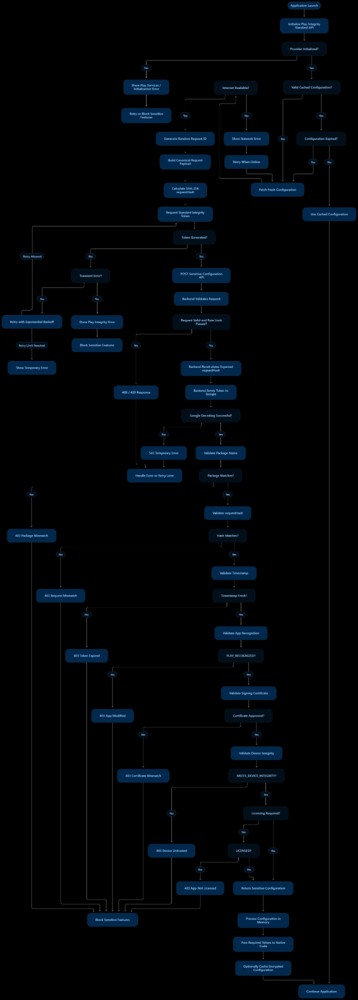
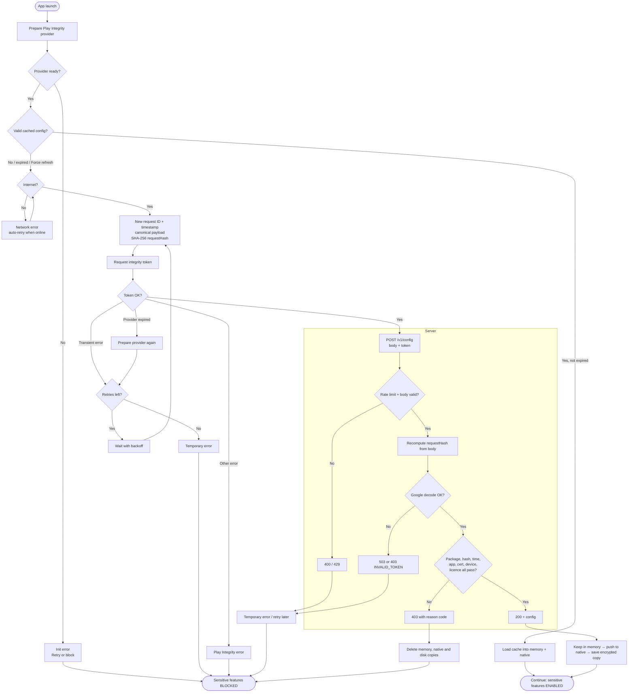

# Play Integrity Demo

An Android app plus a small server that show how to protect **sensitive configuration** with Google's **Play Integrity API (Standard)**.

The app asks Google for an integrity token and sends it to the server. The server checks the token with Google. It sends the configuration back **only if** the app is genuine and the device is trusted.

```
 Android app ──(token + request)──▶ Server ──(token)──▶ Google
      ▲                               │
      └──── config, or 403 "blocked" ◀┘
```

---

## Contents

1. [Quick start (no accounts needed)](#1-quick-start-no-accounts-needed)
2. [What's in the project](#2-whats-in-the-project)
3. [Google Cloud setup](#3-google-cloud-setup)
4. [Play Console setup](#4-play-console-setup)
5. [Server setup](#5-server-setup)
6. [App setup](#6-app-setup)
7. [How it works: diagram, step-by-step flow, config storage and reuse](#7-how-it-works)
8. [Testing](#8-testing)
9. [Before going to production](#9-before-going-to-production)
10. [Troubleshooting](#10-troubleshooting)

---

## 1. Quick start (no accounts needed)

You need **Node.js 18+**. For the app part you also need **Android Studio** with SDK 35, the NDK and CMake 3.22.1.

**Server: run all tests**

```bash
cd server
npm install
npm test
```

**Server: run it locally in mock mode**

1. Copy `server/.env.example` to `server/.env`.
2. In `.env`, set:
   ```
   INTEGRITY_MODE=mock
   ALLOWED_CERT_DIGESTS=mock-cert-digest
   ```
3. Start it with `npm start`. You should see `listening on :8080 (mode=mock)`.
4. In a second terminal (inside `server/`), send a test request:

   macOS / Linux / Git Bash:
   ```bash
   node scripts/mock-token.js pass | curl -s -X POST localhost:8080/v1/config -H "content-type: application/json" -d @-
   ```
   Windows PowerShell:
   ```powershell
   node scripts/mock-token.js pass | curl.exe -s -X POST localhost:8080/v1/config -H "content-type: application/json" -d "@-"
   ```

   Replace `pass` with other scenarios, such as `basic-only`, `unrecognized` or `expired`. The full list is in [8.3](#83-mock-scenarios).

**App: run unit tests**

```bash
./gradlew testDebugUnitTest
```

> Mock mode skips Google entirely. It is for local testing only, and the server refuses to start in mock mode when `NODE_ENV=production`.

---

## 2. What's in the project

```
PlayIntegrityDemo/
├── docs/integrity-flow.webp     decision tree diagram
├── app/                         Android app (Kotlin, Jetpack Compose)
│   └── src/main/java/com/example/playintegrity/
│       ├── data/SecureConfigRepository.kt   ★ the whole client flow
│       ├── integrity/                       token requests, request hash, error handling, retry
│       ├── network/                         server call, internet check
│       ├── cache/ConfigCache.kt             encrypted cache (key in Android Keystore)
│       ├── nativebridge/NativeBridge.kt     passes values to C++ (src/main/cpp)
│       └── ui/                              screen + ViewModel
└── server/                      Node.js (Express)
    ├── src/app.js                           ★ the /v1/config endpoint
    ├── src/integrity/verdictValidator.js    all verdict checks
    ├── src/integrity/decoders.js            Google decoder + mock decoder
    ├── scripts/mock-token.js                makes test requests for mock mode
    ├── test/                                automated tests
    └── .env.example                         all settings
```

---

## 3. Google Cloud setup

Needed for **real** tokens. A Google Cloud account is enough. You don't need a Play developer account for this part.

1. Open [console.cloud.google.com](https://console.cloud.google.com) and create (or pick) a project.
2. Go to **APIs & Services → Library**, search for **Google Play Integrity API** and click **Enable**.
3. Copy the **Project number** from the project **Dashboard**. Use the number, not the project ID. The app needs it.
4. Create a key for the server:
   1. Go to **IAM & Admin → Service accounts → Create service account**. Give it a name; it needs no roles.
   2. Open the account, go to **Keys → Add key → JSON**, and download the file.
   3. Save it as `server/service-account.json`. Git ignores it, so it never gets committed.
   4. Never put this key inside the app.

> Without Play Console (step 4), apps are not "recognized" by Play. You'll get real **device** verdicts but `UNEVALUATED` app verdicts. See [8.1](#81-what-you-can-test-with-which-accounts).

---

## 4. Play Console setup

Needed for the full checks: app recognition, signing certificate, licensing and test verdicts. Requires a Google Play developer account (one-time $25).

1. Create the app in Play Console. Its package name must match `applicationId` in `app/build.gradle.kts`. Change `com.example.playintegrity` to your own package name.
2. Go to **Test and release → App integrity → Play Integrity API → Link a Cloud project**, and choose the project from step 3.
3. Go to **App integrity → App signing** and copy the **SHA-256** of the *App signing key certificate*. The server needs it.
4. Upload a build to **Internal testing** and add your team as testers. Only Play-installed builds get `PLAY_RECOGNIZED`.
5. Optional: **Play Integrity API → Testing responses** lets a tester account get any verdict you choose, such as "rooted device" or "modified app". This is the easiest way to test the block screens on a real phone.

---

## 5. Server setup

### Install and run

```bash
cd server
npm install
cp .env.example .env      # Windows: copy .env.example .env
npm start
```

The server reads `server/.env` on startup. Real environment variables override it.

### Modes

| Mode | `.env` | Use it for |
|---|---|---|
| Mock | `INTEGRITY_MODE=mock` | Local testing without Google |
| Google | `INTEGRITY_MODE=google` plus `GOOGLE_APPLICATION_CREDENTIALS=./service-account.json` | Real tokens |

### Settings (`.env`)

| Setting | Default | What it does |
|---|---|---|
| `EXPECTED_PACKAGE_NAME` | — | Your app's package name (required) |
| `ALLOWED_CERT_DIGESTS` | empty | App signing SHA-256 from Play Console. Paste it as shown (`AB:CD:...`). Empty = check skipped (not allowed in production). |
| `ALLOWED_APP_VERDICTS` | `PLAY_RECOGNIZED` | For testing without Play Console use `PLAY_RECOGNIZED,UNEVALUATED` |
| `REQUIRED_DEVICE_VERDICT` | `MEETS_DEVICE_INTEGRITY` | Use `MEETS_STRONG_INTEGRITY` for high-risk features |
| `REQUIRE_LICENSING` | `false` | `true` = user must have the app from Play |
| `MAX_TOKEN_AGE_MS` | `120000` | How old a token may be (2 min) |
| `RATE_LIMIT_MAX` / `RATE_LIMIT_WINDOW_MS` | `20` / `60000` | Requests per IP per minute |
| `SENSITIVE_CONFIG_JSON` | demo values | The config sent to trusted apps |
| `CONFIG_TTL_SECONDS` / `CONFIG_CACHEABLE` | `3600` / `true` | How long the app may cache it |
| `TRUST_PROXY` | `false` | Set `true` behind a load balancer |

Docker:

```bash
docker build -t play-integrity-server server
```

---

## 6. App setup

### Configure

Edit `gradle.properties`:

```properties
PLAY_INTEGRITY_CLOUD_PROJECT_NUMBER=123456789012   # from section 3, step 3
INTEGRITY_BACKEND_URL=http://10.0.2.2:8080/        # see "Connect to the server" below
```

### Build

Open the project folder in Android Studio and press **Run**, or use the command line:

```bash
./gradlew assembleDebug
```

### Connect to the server

| Where the app runs | `INTEGRITY_BACKEND_URL` | Extra step |
|---|---|---|
| Emulator | `http://10.0.2.2:8080/` | none |
| Real phone over USB | `http://localhost:8080/` | Run `adb reverse tcp:8080 tcp:8080`. Undo it with `adb reverse --remove tcp:8080`. |
| Deployed server | `https://your-server.com/` | Release builds must use HTTPS |

Plain HTTP is allowed only for `10.0.2.2` and `localhost` (see `res/xml/network_security_config.xml`).

### What you'll see

The screen shows **Sensitive features: ENABLED** or **BLOCKED**, the reason, and a step-by-step log. It has three buttons:
- **Retry** runs the flow again.
- **Force refresh** ignores the cache.
- **Clear** deletes all stored config.

---

## 7. How it works

- [7.1 Decision tree](#71-decision-tree)
- [7.2 The flow, step by step](#72-the-flow-step-by-step)
- [7.3 Where the config is stored](#73-where-the-config-is-stored)
- [7.4 How the config is reused](#74-how-the-config-is-reused)
- [7.5 Server checks](#75-server-checks-post-v1config)
- [7.6 Why the request hash matters](#76-why-the-request-hash-matters)

### 7.1 Decision tree

The original design diagram ([full size](docs/integrity-flow.webp)):

<p align="center"></p>

The same flow as the code implements it. GitHub and Android Studio's Markdown preview render this:



### 7.2 The flow, step by step

Everything below is in [SecureConfigRepository.kt](app/src/main/java/com/example/playintegrity/data/SecureConfigRepository.kt). It runs on every app start, and again when you tap **Retry** or **Force refresh**.

**Step 1: Prepare the integrity provider.**
The app calls `prepareIntegrityToken(cloudProjectNumber)` once. Google warms up in the background, which can take a few seconds, so later token requests are fast. If it fails (no Play Store, old Play services, wrong project number), the screen shows an initialization error and sensitive features stay blocked.

**Step 2: Look in the cache.**
The app reads the encrypted copy from disk. If it exists and hasn't expired, the app loads it into memory and native code and **stops here, without calling the server**. **Force refresh** skips this step.

**Step 3: Check the internet.**
If there is no connection, the app shows "No internet" and waits. As soon as the phone is back online, the flow starts again by itself.

**Step 4: Build the request.**
The app creates:
- a **request ID**: 32 random hex characters, never reused
- a **timestamp**
- the **package name** and **version code**
- a **scope**, which says which config set is wanted (`default`)

**Step 5: Hash it and get a token.**
These fields are joined into one text and hashed with SHA-256. The app asks Play for a token *bound to that hash*. What happens when that fails:

| Problem | What the app does |
|---|---|
| Temporary (network, Google busy, too many requests) | Waits a random time of up to 0.5s, then up to 1s, then up to 2s and retries, up to 4 tries in total, each with a new request |
| Provider expired | Prepares the provider again, then retries |
| Anything else | Shows an integrity error and blocks |

**Step 6: Send it to the server.**
The app POSTs the request fields plus the token to `/v1/config`.

**Step 7: The server checks it.**
The server runs the checks in [7.5](#75-server-checks-post-v1config). It only returns the config if **every** check passes.

**Step 8: Handle the answer.**

| Server answer | What the app does |
|---|---|
| `200` + config | Stores it (see 7.3) → **ENABLED** |
| `403` (any reason) | **Deletes every copy** (memory, native, disk) → **BLOCKED** |
| `429` / `503` / other 5xx | "Temporary error, try later" (shows `Retry-After` if given) → BLOCKED for now |
| `400` | Treated as an app bug, not retried → BLOCKED |
| Connection lost | "No internet" (auto-retry) or "Could not reach server" |

**Sensitive features are enabled only after step 2 (valid cache) or a `200` in step 8.** Every other path blocks them.

### 7.3 Where the config is stored

Once the server returns the config, it can exist in up to three places on the phone:

| Where | What's stored | Code | How long it lives | Removed when |
|---|---|---|---|---|
| **App memory** | All values | `SecureConfigRepository.current` | Until the app process ends | 403, **Clear**, app killed |
| **Native memory (C++)** | Only `nativeApiKey`, `nativeEndpoint`, `nativeFeatureSalt` (`NativeBridge.NATIVE_KEYS`) | [secure_config.cpp](app/src/main/cpp/secure_config.cpp) | Until the app process ends | 403, **Clear**, app killed. Memory is zeroed, not just freed. |
| **Encrypted disk cache** | All values + `issuedAt`, `ttlSeconds` | [ConfigCache.kt](app/src/main/java/com/example/playintegrity/cache/ConfigCache.kt) → SharedPreferences `secure_config_cache` | Until it expires (`issuedAt + ttlSeconds`, default 1 hour) | 403, **Clear**, server sends `cacheable: false`, file tampered or unreadable |

How the disk copy is protected:
- It's encrypted with **AES-256-GCM**. The key (`secure_config_cache_key_v1`) lives in the **Android Keystore**, and the app can use it but cannot export it. A copied file is useless on another phone.
- If the file was edited or can't be decrypted, it is deleted and the app fetches fresh config.
- `android:allowBackup="false"`, so it isn't included in cloud or adb backups.
- Native code logs only key **names**, never values.

The **server** is the source of truth. The config comes from `SENSITIVE_CONFIG_JSON`, and the response is sent with `Cache-Control: no-store` so proxies don't keep it. The server also decides the cache rules through `CONFIG_TTL_SECONDS` and `CONFIG_CACHEABLE`.

### 7.4 How the config is reused

```
Launch 1 (first run) ──▶ no cache ──▶ token ──▶ server ──▶ 200 ──▶ memory + native + disk     [server call]
Launch 2 (10 min later) ─▶ cache valid ──▶ memory + native                                    [no server call]
Launch 3 (2 hours later) ▶ cache expired ──▶ token ──▶ server ──▶ 200 ──▶ cache replaced      [server call]
Device gets rooted ─────▶ next server call ──▶ 403 DEVICE_UNTRUSTED ──▶ all copies deleted   [blocked]
Launch after that ──────▶ no cache ──▶ token ──▶ server ──▶ 403 again                         [blocked]
```

Things to know:
- **While the cache is valid, the device isn't checked again.** The TTL is a trade-off. A shorter TTL means more frequent checks but more server and Google calls (quota is 10k/day by default). A longer TTL means fewer calls but slower reaction to a device going bad.
- **A 403 never falls back to the cache.** Blocking deletes the cache too, so an old "good" copy can't be used after a bad verdict.
- The provider is prepared (step 1) even when the cache is used, as the diagram shows. So a phone without working Play services is blocked even if it has a cached copy.
- Expiry uses the **phone's clock** against the server's `issuedAt`. If the phone clock is set far back, the cache lives longer. To stop that, keep the TTL short or have the server check a fresh token for very sensitive actions.
- Turn caching off completely with `CONFIG_CACHEABLE=false`. Every launch then calls the server, and the config lives in memory only.

### 7.5 Server checks (`POST /v1/config`)

Checks run in this order. The first failure stops the request.

| # | Check | If it fails |
|---|---|---|
| 1 | Not too many requests from this IP | `429 RATE_LIMITED` |
| 2 | Request body is valid | `400 BAD_REQUEST` |
| 3 | Request ID not used before | `403 REPLAYED_REQUEST` |
| 4 | Google can decode the token | `503 INTEGRITY_UNAVAILABLE` (Google down) / `403 INVALID_TOKEN` (fake token) |
| 5 | Package name matches | `403 PACKAGE_MISMATCH` |
| 6 | Request hash matches the body | `403 REQUEST_MISMATCH` |
| 7 | Token is fresh | `403 TOKEN_EXPIRED` |
| 8 | App is `PLAY_RECOGNIZED` | `403 APP_NOT_RECOGNIZED` (modified app) |
| 9 | Signing certificate is approved | `403 CERTIFICATE_MISMATCH` |
| 10 | Device has `MEETS_DEVICE_INTEGRITY` | `403 DEVICE_UNTRUSTED` |
| 11 | User is licensed (if required) | `403 NOT_LICENSED` |
| ✅ | All passed | `200` with the config |

### 7.6 Why the request hash matters

The app and the server build the same text from the request and hash it:

```
v1 / POST / /v1/config / requestId / timestamp / packageName / versionCode / scope   (joined by new lines)
```

Google signs that hash into the token. If anyone changes the request on the way, the server's hash won't match and it returns `REQUEST_MISMATCH`. A copied request can't be sent again either, because each request ID works only once.

If you change this format, change **both** `RequestHasher.kt` and `server/src/integrity/requestHash.js`. The tests on both sides check the same expected hash, so a mismatch fails the build.

---

## 8. Testing

### 8.1 What you can test with which accounts

| You have | What you can test |
|---|---|
| Nothing | All automated tests and every server check, using mock mode and curl |
| Google Cloud project | Real tokens on a real phone with the Play Store. Device verdicts are real; the app verdict is `UNEVALUATED`, so set `ALLOWED_APP_VERDICTS=PLAY_RECOGNIZED,UNEVALUATED` and leave `ALLOWED_CERT_DIGESTS` empty. |
| Play Console account | Everything: `PLAY_RECOGNIZED`, certificate check, licensing, and forced verdicts via *Testing responses* |

### 8.2 Automated tests

| Command | Covers |
|---|---|
| `cd server && npm test` | Every server check: 22 endpoint tests + 8 unit tests |
| `./gradlew testDebugUnitTest` | Every app branch: cache, offline, retry, provider re-prepare, 400/403/429, wipe on block, hash format |

### 8.3 Mock scenarios

Use with `node scripts/mock-token.js <scenario>` while the server runs in mock mode.

| Scenario | Simulates | Expected |
|---|---|---|
| `pass` | Genuine app, trusted device | `200` |
| `strong` | Device with strong integrity | `200` |
| `wrong-package` | Token from another app | `403 PACKAGE_MISMATCH` |
| `wrong-hash` | Request changed after the token was made | `403 REQUEST_MISMATCH` |
| `expired` | Old token | `403 TOKEN_EXPIRED` |
| `unrecognized` | Modified or sideloaded app | `403 APP_NOT_RECOGNIZED` |
| `bad-cert` | Re-signed APK | `403 CERTIFICATE_MISMATCH` |
| `basic-only` | Rooted or unlocked device | `403 DEVICE_UNTRUSTED` |
| `no-verdict` | Emulator or hooked device | `403 DEVICE_UNTRUSTED` |
| `unlicensed` | Not installed from Play (needs `REQUIRE_LICENSING=true`) | `403 NOT_LICENSED` |
| `google-down` | Google servers unavailable | `503` |
| `google-invalid` | Fake token | `403 INVALID_TOKEN` |

Sending the same `pass` request body twice returns `403 REPLAYED_REQUEST` the second time.

### 8.4 Manual checklist (real phone + real server)

| # | Do this | Expect |
|---|---|---|
| 1 | Fresh install from Play, launch | ENABLED (from network) |
| 2 | Close and reopen the app | ENABLED (from cache, no server call) |
| 3 | Clear → turn on airplane mode → Retry | "No internet" |
| 4 | Turn airplane mode off | Reloads by itself → ENABLED |
| 5 | Stop the server → Force refresh | "Temporary error" |
| 6 | Set `RATE_LIMIT_MAX=1`, tap Force refresh twice | "Temporary error (429)" |
| 7 | Install a debug APK with `adb install` | BLOCKED: `APP_NOT_RECOGNIZED` |
| 8 | Testing response "no device integrity" | BLOCKED: `DEVICE_UNTRUSTED` |
| 9 | After #1, switch to the bad testing response → Force refresh → reopen app | Still BLOCKED (cache was deleted) |
| 10 | Wrong project number in `gradle.properties` | Integrity error: invalid Cloud project number |
| 11 | Rename `service-account.json` on the server | "Temporary error (503)" |
| 12 | `adb logcat -s SecureConfigNative` after #1 | Shows keys only, never values |

---

## 9. Before going to production

**Must do**
- [ ] Set `NODE_ENV=production`. The server then refuses mock mode, an empty certificate list and relaxed app verdicts.
- [ ] Set `ALLOWED_CERT_DIGESTS` to the Play **App signing** SHA-256.
- [ ] Serve over **HTTPS** and use an `https://` URL in release builds.
- [ ] Keep the service-account key and `SENSITIVE_CONFIG_JSON` in a secret manager, not in `.env`. Rotate the key regularly.
- [ ] If you run more than one server instance, move replay protection and rate limiting to **Redis**. They are in memory today.
- [ ] Request a higher Play Integrity quota if you expect more than **10,000 requests/day**.

**Should do**
- [ ] Alerts for spikes in `REQUEST_MISMATCH`, `REPLAYED_REQUEST` or `DEVICE_UNTRUSTED`, for Google errors, and for quota use.
- [ ] Decide what happens when Google is down. Today the server blocks (fails closed).
- [ ] Certificate pinning in the app (OkHttp `CertificatePinner`).
- [ ] Send only the values the app really needs. Prefer short-lived tokens over permanent API keys.
- [ ] Consider Play's remediation dialogs, which let users fix the problem instead of hitting a hard block.
- [ ] Optional extra verdicts in Play Console: Play Protect status, risky apps running, recent device activity.

---

## 10. Troubleshooting

| Problem | Fix |
|---|---|
| Gradle: *SDK location not found* | Create `local.properties` with `sdk.dir=C\:/Users/<you>/AppData/Local/Android/Sdk` (or let Android Studio create it) |
| Gradle fails with a JDK error | Use Android Studio's bundled JDK (Settings → Build Tools → Gradle → Gradle JDK) |
| App: *Play services / initialization error* | The emulator image needs **Google Play**, and the project number must be set |
| App: *CLOUD_PROJECT_NUMBER_IS_INVALID* | Use the project **number**, not the ID, and check the API is enabled |
| App: *Could not reach server* | Emulator → `10.0.2.2`. Phone → run `adb reverse tcp:8080 tcp:8080` and use `localhost` |
| App: *Cleartext HTTP not permitted* | Only `10.0.2.2` and `localhost` may use HTTP |
| Server always returns `503` | Wrong or missing `service-account.json`, or the API is not enabled in that project |
| Server returns `APP_NOT_RECOGNIZED` | The build wasn't installed from Play. Use internal testing, or allow `UNEVALUATED` for local tests. |
| Server returns `INVALID_TOKEN` | The token is for a different package or Cloud project than the server expects |
| Server won't start: *Invalid configuration* | Read the message. It lists exactly which setting is missing or unsafe. |
